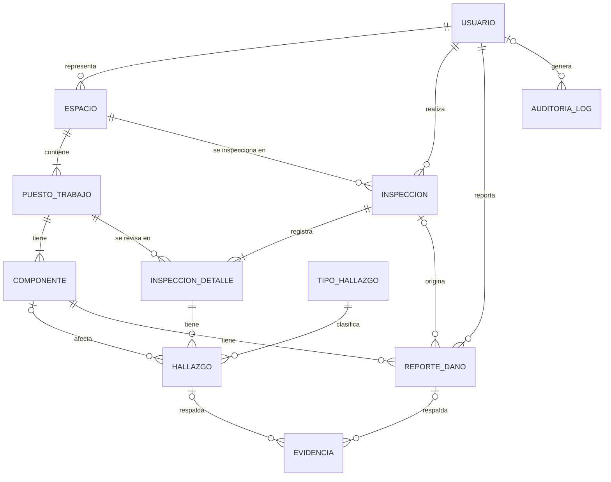

# Auditoría de espacios de estudio

Sistema web para llevar un registro estructurado y auditable del estado de los equipos de un área de estudio compuesta por **4 salones de clase y un espacio de trabajo libre**.

Cada puesto de trabajo tiene torre, pantalla, teclado, mouse y sus cables. Como algunos estudiantes desconectan periféricos para usar sus propios dispositivos, o dejan basura y los puestos desordenados, el sistema deja **constancia de cómo se entrega el espacio el viernes en la tarde y cómo se recibe el lunes en la mañana**, y permite reportar daños físicos con evidencia fotográfica.

---

## Contenido

- [Funcionalidades](#funcionalidades)
- [Roles y permisos](#roles-y-permisos)
- [Tecnologías](#tecnologías)
- [Estructura del repositorio](#estructura-del-repositorio)
- [Puesta en marcha](#puesta-en-marcha)
- [Configuración](#configuración)
- [Reglas de negocio](#reglas-de-negocio)
- [Modelo de datos](#modelo-de-datos)
- [API REST](#api-rest)
- [Seguridad](#seguridad)
- [Probar desde el celular](#probar-desde-el-celular)
- [Estado del proyecto](#estado-del-proyecto)
- [Problemas frecuentes](#problemas-frecuentes)

---

## Funcionalidades

- **Inspecciones semanales** de viernes (entrega) y lunes (recepción) por espacio. Cada puesto se marca con un toque como **OK**, o como **Con novedades** indicando de forma explícita cuáles son las falencias (basura, periférico faltante o desconectado, daño físico, etc.).
- **Evidencia fotográfica** tomada desde el celular, asociada a cada hallazgo. Las fotos se reducen en el navegador antes de subirse.
- **Reportes de daño físico**, creados automáticamente al cerrar una inspección o manualmente por técnicos y por el representante de cada espacio, con seguimiento de estado (`ABIERTO` → `EN_REVISION` → `RESUELTO`).
- **Comparación viernes vs. lunes**: puesto por puesto, qué novedades son nuevas, cuáles persisten y cuáles desaparecieron durante el fin de semana.
- **Auditoría automática**: cada acción relevante (crear, modificar, cerrar, cambiar estado, subir evidencia, iniciar sesión) queda registrada con su autor y fecha.
- **Autenticación con roles** y menú adaptado a cada perfil.
- **Interfaz responsive** pensada para usarse de pie con un celular o tablet, con modo claro y oscuro.

## Roles y permisos

| Acción | ADMIN | TECNICO | REPRESENTANTE |
|---|:---:|:---:|:---:|
| Gestionar usuarios, espacios, puestos y componentes | ✅ | ❌ | ❌ |
| Consultar catálogos, inspecciones, comparaciones y reportes | ✅ | ✅ | ✅ |
| Crear, registrar y cerrar inspecciones; subir fotos a hallazgos | ✅ | ✅ | ❌ |
| Crear reportes de daño | ✅ | ✅ | ✅ (solo en su espacio) |
| Cambiar el estado de un reporte de daño | ✅ | ✅ | ❌ |
| Consultar el registro de auditoría | ✅ | ❌ | ❌ |

## Tecnologías

| Capa | Tecnología |
|---|---|
| Backend | Java 21, Spring Boot 4, Spring Web, Spring Data JPA (Hibernate), Spring Security (JWT con Nimbus), Bean Validation, Lombok |
| Base de datos | MySQL 8 |
| Frontend | React, Vite, React Router, CSS propio (sin framework de UI) |
| Autenticación | JWT firmado con HS256, contraseñas con BCrypt |

La identidad visual (naranja y azul noche) se basa en los logos de **Prexxa** y **Campuslands**.

## Estructura del repositorio

```
Auditoria_espacios/
├── Backend/auditoria_espacios/          # API REST (Spring Boot, Maven)
│   └── src/main/java/com/jotaa/auditoria_espacios/
│       ├── configuration/              # Seguridad, CORS, JWT, admin inicial
│       ├── controller/
│       ├── dto/                        # request / response
│       ├── entity/                     # entidades JPA (+ enumerated)
│       ├── exception/                  # excepciones y manejo global de errores
│       ├── repository/
│       └── service/                    # interfaces (+ serviceImpl)
└── Frontend/                            # SPA (React + Vite)
    ├── public/logos/                   # prexxa.png, campuslands.png
    └── src/
        ├── api/client.js               # cliente HTTP (token, errores, fotos)
        ├── auth/                       # sesión y rutas protegidas por rol
        ├── components/
        ├── pages/
        ├── utils/formato.js            # etiquetas, fechas, reducción de imágenes
        └── index.css                   # tema claro/oscuro        
```

## Puesta en marcha

### Requisitos

- JDK 21
- MySQL 8
- Node.js 20.19 o superior
- Maven (el proyecto incluye el wrapper `mvnw`)

### 1. Base de datos

Crea el esquema ejecutando el script SQL del proyecto, que crea la base `auditoria_espacios` con sus 11 tablas. Después carga el catálogo de tipos de hallazgo, sin el cual el formulario de novedades no tiene opciones:

```sql
insert into tipo_hallazgo (codigo, nombre, categoria) values
 ('BASURA','Basura en el puesto','LIMPIEZA'),
 ('SUCIEDAD','Superficie o equipo sucio','LIMPIEZA'),
 ('SILLA_DESORDENADA','Silla mal acomodada','ORDEN'),
 ('CABLES_DESORDENADOS','Cables mal acomodados','ORDEN'),
 ('PERIFERICO_FALTANTE','Periférico faltante','PERIFERICO'),
 ('PERIFERICO_DESCONECTADO','Periférico desconectado','PERIFERICO'),
 ('PERIFERICO_CAMBIADO','Periférico distinto al original','PERIFERICO'),
 ('DANO_VISIBLE','Daño físico visible','DANO_FISICO'),
 ('OTRO','Otro (ver descripción)','ORDEN');
```

El esquema lo define el script SQL: Hibernate no crea ni modifica tablas.

### 2. Backend

Genera una clave secreta para firmar los tokens (32 bytes en Base64):

```bash
openssl rand -base64 32
```

Define las variables de entorno (ejemplo en PowerShell) y arranca:

```powershell
$env:APP_JWT_SECRET      = "la_clave_generada"
$env:APP_ADMIN_CORREO    = "admin@tuempresa.com"
$env:APP_ADMIN_PASSWORD  = "UnaClaveLarga123"

cd Backend/auditoria_espacios
./mvnw spring-boot:run
```

En Linux o macOS usa `export VARIABLE=valor` en lugar de `$env:`.

La API queda en `http://localhost:8080`. Al primer arranque se crea el usuario administrador con las credenciales indicadas, solo si todavía no existe ningún administrador. Después puedes quitar `APP_ADMIN_PASSWORD` de las variables de entorno.

Documentación interactiva de la API (Swagger UI): `http://localhost:8080/swagger-ui/index.html`.

### 3. Frontend

Crea `Frontend/.env`:

```
VITE_API_URL=http://localhost:8080
```

```bash
cd Frontend
npm install
npm run dev
```

Abre `http://localhost:5173` e inicia sesión con el administrador. Desde ahí se crean los demás usuarios (técnicos y representantes).

> El frontend debe correr en el puerto **5173**: es el origen que el backend permite por CORS. Vite está configurado con `strictPort` para que no cambie de puerto sin avisar.

## Configuración

### Variables de entorno

| Variable | Descripción |
|---|---|
| `APP_JWT_SECRET` | Clave HMAC en Base64 (32 bytes) para firmar los tokens. **Obligatoria.** |
| `APP_ADMIN_CORREO` | Correo del administrador inicial. |
| `APP_ADMIN_PASSWORD` | Contraseña del administrador inicial. |
| `SPRING_DATASOURCE_URL` | Opcional: sobrescribe la URL de MySQL. |
| `SPRING_DATASOURCE_USERNAME` | Opcional: usuario de MySQL. |
| `SPRING_DATASOURCE_PASSWORD` | Opcional: contraseña de MySQL. |

### `application.properties` (resumen)

```properties
spring.datasource.url=jdbc:mysql://localhost:3306/auditoria_espacios?serverTimezone=America/Bogota
spring.datasource.username=TU_USUARIO
spring.datasource.password=TU_PASSWORD
spring.jpa.open-in-view=false

app.jwt.secret=${APP_JWT_SECRET}
app.jwt.expiracion-minutos=480
app.admin.correo=${APP_ADMIN_CORREO:}
app.admin.password=${APP_ADMIN_PASSWORD:}

# orígenes permitidos por CORS (separados por comas)
app.cors.origins=http://localhost:5173

# evidencias fotográficas
app.uploads.dir=uploads
spring.servlet.multipart.max-file-size=5MB
spring.servlet.multipart.max-request-size=6MB
```

Las fotos se guardan en la carpeta `uploads/` (no la subas a git) y en la base solo se guarda su nombre de archivo.

## Reglas de negocio

**Inspecciones**

- Hay una inspección por espacio, tipo (`VIERNES_ENTREGA` o `LUNES_RECEPCION`) y fecha. No se puede duplicar.
- Una inspección nace en estado `BORRADOR` y pasa a `CERRADA`. **Una vez cerrada no se puede modificar**: es la constancia.
- Para cerrarla deben estar registrados todos los puestos activos del espacio.
- El inspector es el usuario autenticado; no se envía en la petición.

**Puestos**

- Un puesto `OK` no puede tener hallazgos; uno `CON_NOVEDADES` debe tener al menos uno.
- Un hallazgo de tipo `OTRO` exige descripción.
- Un hallazgo de daño físico exige el componente afectado y la gravedad (`LEVE`, `MODERADO`, `GRAVE`).
- Un hallazgo se identifica por su tipo y su componente. Al volver a guardar un puesto, los hallazgos que se mantienen conservan sus fotos.
- Los puestos no se eliminan, se desactivan, para no romper el historial.

**Reportes de daño**

- Al cerrar una inspección, cada hallazgo de daño físico genera su reporte automáticamente y hereda las fotos del hallazgo.
- El estado solo avanza: `ABIERTO` → `EN_REVISION` → `RESUELTO`. Un reporte resuelto no se reabre.
- Un representante solo puede reportar daños en el espacio que representa.

**Comparación viernes vs. lunes**

Solo se comparan inspecciones cerradas. Para cada puesto se cruzan los hallazgos de ambos días:

| Estado | Significado |
|---|---|
| `NUEVA_NOVEDAD` | El lunes tiene hallazgos que el viernes no tenía |
| `PERSISTE` | Sin hallazgos nuevos, pero hay hallazgos que siguen igual |
| `RESUELTO` | El viernes tenía hallazgos y el lunes ninguno |
| `SIN_CAMBIOS` | Ambos días el puesto estaba `OK` |
| `SIN_REGISTRO` | El puesto aparece en una inspección y en la otra no |

**Evidencias**

- Solo imágenes JPG, PNG o WEBP, de hasta 5 MB. El frontend las reduce a un máximo de 1600 px antes de subirlas.
- Se guardan con un nombre aleatorio; nunca se usa el nombre que envía el cliente.

**Auditoría**

- El registro se guarda en la misma transacción que la acción: si la acción falla y se revierte, el registro también.
- Las contraseñas nunca se escriben en el registro.

## Modelo de datos



## API REST

Todas las rutas, salvo el login, requieren el header `Authorization: Bearer <token>`.

| Recurso | Endpoints | Acceso |
|---|---|---|
| Sesión | `POST /api/auth/login`, `GET /api/auth/me` | Público / autenticado |
| Usuarios | `GET/POST /api/usuarios`, `GET/PUT /api/usuarios/{id}`, `PATCH /api/usuarios/{id}/password` | ADMIN |
| Espacios | `GET /api/espacios`, `POST/PUT/DELETE` | Lectura: todos. Escritura: ADMIN |
| Puestos | `GET /api/puestos?espacioId=`, `POST/PUT`, `DELETE` (desactiva) | Lectura: todos. Escritura: ADMIN |
| Componentes | `GET /api/componentes?puestoId=`, `POST/PUT/DELETE` | Lectura: todos. Escritura: ADMIN |
| Tipos de hallazgo | `GET /api/tipos-hallazgo` | Autenticado |
| Inspecciones | `GET/POST /api/inspecciones`, `GET /api/inspecciones/{id}`, `PUT /api/inspecciones/{id}/puestos/{puestoId}`, `POST /api/inspecciones/{id}/cerrar` | Lectura: todos. Escritura: ADMIN, TECNICO |
| Comparación | `GET /api/inspecciones/{lunesId}/comparacion?viernesId=` | Autenticado |
| Reportes de daño | `GET /api/reportes-dano?estado=&espacioId=`, `POST /api/reportes-dano`, `GET /api/reportes-dano/{id}`, `PATCH /api/reportes-dano/{id}/estado` | Lectura y creación: todos. Cambio de estado: ADMIN, TECNICO |
| Evidencias | `POST /api/hallazgos/{id}/evidencias`, `GET /api/hallazgos/{id}/evidencias`, `POST /api/reportes-dano/{id}/evidencias`, `GET /api/evidencias/{id}/archivo` | Autenticado (subir a hallazgos: ADMIN, TECNICO) |
| Auditoría | `GET /api/auditoria?entidad=&usuarioId=&desde=&hasta=&page=&size=` | ADMIN |

Los errores se devuelven con el formato `ProblemDetail` (RFC 9457):

| Código | Cuándo |
|---|---|
| `400` | Datos inválidos o reglas de negocio incumplidas |
| `401` | Credenciales inválidas o token ausente o expirado |
| `403` | El rol no tiene permiso |
| `404` | Recurso no encontrado |
| `409` | Conflicto de estado (duplicado, inspección cerrada, dependencias) |

## Seguridad

- Tokens JWT firmados con HS256 que expiran a las 8 horas. El rol viaja en el claim `rol`.
- Contraseñas almacenadas con BCrypt. Las respuestas de la API nunca incluyen la contraseña.
- El mensaje de login fallido es el mismo si el correo no existe, la clave es incorrecta o el usuario está desactivado.
- Las rutas no declaradas explícitamente en la configuración de seguridad quedan **denegadas**.
- Las claves y el administrador inicial se pasan por variables de entorno, no se versionan.
- El frontend guarda la sesión en `sessionStorage`: se pierde al cerrar la pestaña.
- Antes de publicar el sistema en internet se debe servir todo por **HTTPS** y revisar el almacenamiento del token.

## Probar desde el celular

1. Conecta el celular y el PC a la misma red Wi-Fi.
2. Averigua la IP del PC (`ipconfig`) y abre los puertos 5173 y 8080 en el firewall para redes privadas.
3. En `Frontend/.env.local`:
   ```
   VITE_API_URL=http://192.168.1.20:8080
   ```
4. En el backend, agrega el origen del celular a `app.cors.origins` (por ejemplo `http://192.168.1.20:5173`) y reinícialo.
5. Arranca Vite visible en la red y abre la dirección que muestra en el celular:
   ```bash
   npm run dev -- --host
   ```

El botón **Agregar foto** abre la cámara trasera del teléfono.

## Estado del proyecto

**Backend**

- [x] Autenticación JWT con roles y CRUD de usuarios
- [x] CRUD de espacios, puestos y componentes
- [x] Inspecciones, hallazgos y cierre
- [x] Reportes de daño con evidencias
- [x] Comparación viernes vs. lunes
- [x] Auditoría automática

**Frontend**

- [x] Login y navegación por rol
- [x] Inspecciones (lista, creación, registro de puestos, hallazgos, fotos y cierre)
- [x] Comparación viernes vs. lunes
- [x] Reportes de daño
- [x] Administración (espacios, puestos, componentes y usuarios)
- [x] Auditoría

**Pendiente**

- [x] Descargar y enviar por correo el reporte de cada inspección (PDF)
- [x] Limitar al representante a ver únicamente los datos de su espacio
- [ ] Aplicación instalable (PWA), que requiere HTTPS

## Problemas frecuentes

| Síntoma | Causa probable |
|---|---|
| El login muestra "No se pudo conectar con el servidor" | El backend no está corriendo o `VITE_API_URL` apunta a otra dirección. Reinicia Vite tras cambiar el `.env`. |
| Error de CORS en la consola del navegador | El origen del frontend no está en `app.cors.origins`. Reinicia el backend. |
| `403` con `insufficient_scope` en rutas de un rol | El token no trae el claim `rol`. Verifica `JwtService` y vuelve a iniciar sesión. |
| El formulario de novedades no tiene opciones | La tabla `tipo_hallazgo` está vacía. Carga el catálogo. |
| La sesión se cierra apenas se inicia | El frontend lee la expiración del propio token; borra `auditoria.sesion` de Session Storage y reintenta. |
| El backend no arranca por `app.jwt.secret` | Falta `APP_JWT_SECRET` o no es una clave Base64 de 32 bytes. |